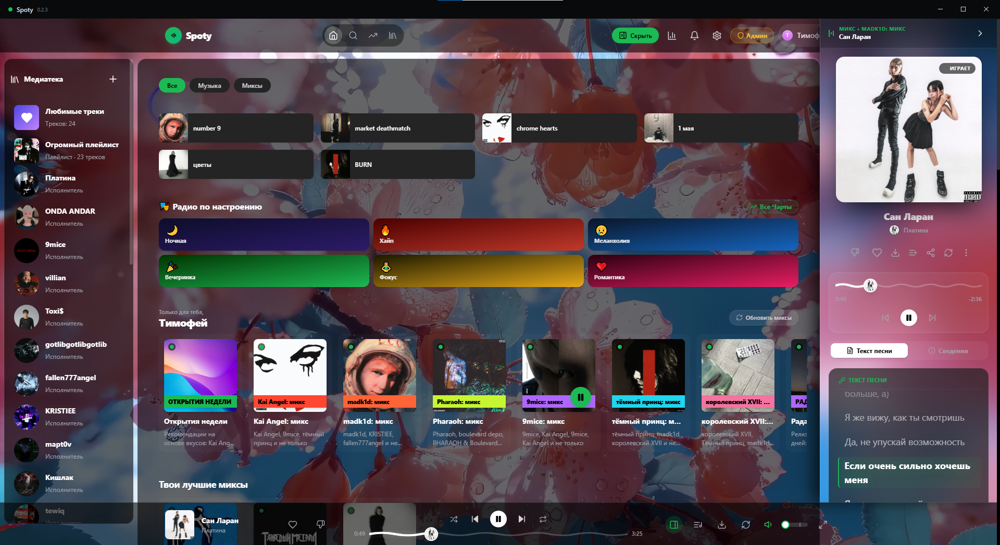
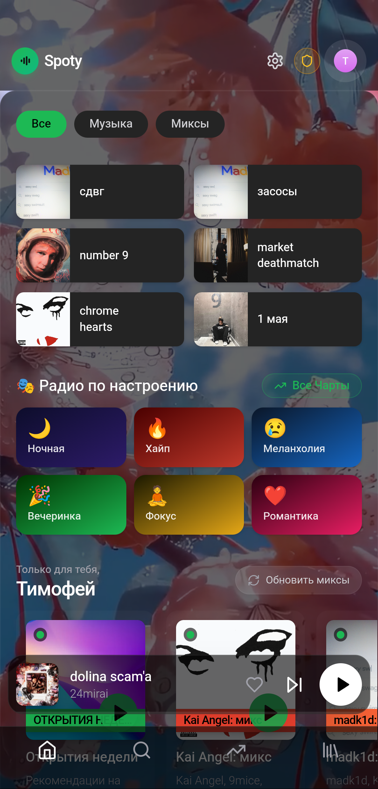

# Spoty

**Your music, on Windows and Android.**

[Русский](README.ru.md)

A music app with a shared account and library across devices. Search tracks, build playlists, discover personalized mixes and keep listening in the background. Sign in through Telegram.

**[Windows installer](https://github.com/kabachok-hub/spoty-app/releases/download/v0.2.4/Spoty-Setup.exe)** · **[Android APK](https://github.com/kabachok-hub/spoty-app/releases/download/v0.2.4/Spoty-Android-0.2.4.apk)**

## Why Spoty?

- **One library across devices** — favorites and playlists tied to your account.
- **Music to match your mood** — recommendations, mixes and lyrics.
- **Make it yours** — themes, backgrounds and visual performance settings.

## Windows

## Android

## Install

**Windows 10/11 x64:** run `Spoty-Setup.exe` and follow the installer. Before updating, quit Spoty from the system tray.

**Android 6+:** install the APK, then sign in through Telegram. Install updates over the existing app.

Updates are installed manually. All downloads: [Releases](https://github.com/kabachok-hub/spoty-app/releases).

## Development & feedback

React + TypeScript, Kotlin + Media3 on Android, Electron on Windows. [Build instructions](docs/BUILD.md).

Found a bug or have an idea? [Open an issue](https://github.com/kabachok-hub/spoty-app/issues). For bugs, include the app version, your operating system and steps to reproduce. Please keep account details and tokens private.
