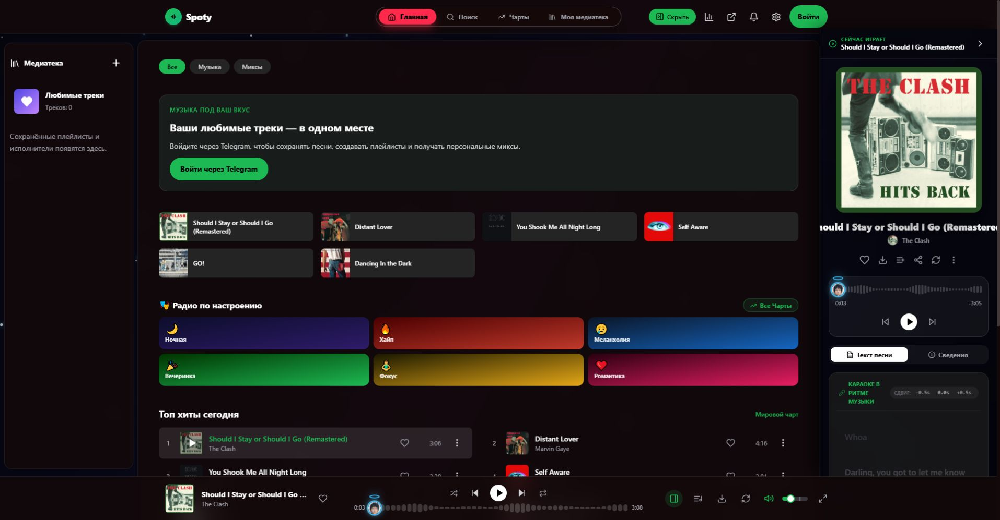

# Spoty

**Твоя музыка на Windows и Android.**

[English](README.md)

Музыкальное приложение с общим аккаунтом и библиотекой на всех устройствах. Поиск треков, плейлисты, персональные миксы, тексты песен и фоновое воспроизведение. Вход через Telegram.

**[Скачать для Windows](https://github.com/kabachok-hub/spoty-app/releases/download/v0.2.3/Spoty-Setup.exe)** · **[Скачать для Android](https://github.com/kabachok-hub/spoty-app/releases/download/v0.2.3/Spoty-Android-0.2.3.apk)**

## Зачем пробовать Spoty?

- **Одна библиотека на разных устройствах** — избранное и плейлисты привязаны к аккаунту.
- **Музыка под настроение** — рекомендации, миксы и тексты песен.
- **Оформление под себя** — темы, фоны и настройки нагрузки на систему.

## Интерфейс

  

  

## Установка

**Windows 10/11 x64:** запусти `Spoty-Setup.exe` и пройди установку. Перед обновлением заверши приложение через меню трея.

**Android 6+:** установи APK и войди через Telegram. Обновления устанавливаются поверх предыдущей версии.

Обновления пока устанавливаются вручную. Все версии — в [Releases](https://github.com/kabachok-hub/spoty-app/releases).

## Разработка и обратная связь

React + TypeScript, Android на Kotlin + Media3, Windows на Electron. [Инструкция сборки](docs/BUILD.md).

Нашёл ошибку или есть идея? [Создай issue](https://github.com/kabachok-hub/spoty-app/issues). Для ошибки укажи версию приложения, ОС и шаги воспроизведения. Не прикладывай личные данные и токены.
